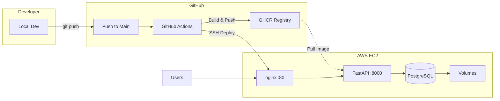
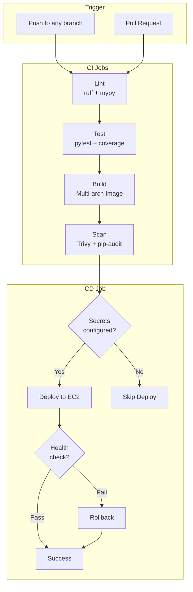

# TaskFlow API

> Containerized FastAPI + PostgreSQL application with a complete CI/CD pipeline that tests, builds, and deploys to AWS EC2 on every push.

[](https://github.com/Koushik926/Containerised-App-with-CI-CD-to-AWS/actions/workflows/ci-cd.yml)
[](https://github.com/Koushik926/Containerised-App-with-CI-CD-to-AWS/actions/workflows/terraform-ci.yml)


[](LICENSE)

## Architecture



## CI/CD Pipeline



## Features

This project demonstrates the full resume line:

| Resume Claim | Implementation |
|-------------|----------------|
| Containerized FastAPI + PostgreSQL | Multi-stage Dockerfile, docker-compose for dev/prod |
| Docker Compose | Separate configs for dev, test, and production |
| GitHub Actions pipeline | 5-job workflow: lint → test → build → scan → deploy |
| Tests on every push | pytest with 85%+ coverage gate |
| Builds multi-arch images | linux/amd64 + linux/arm64 via buildx |
| Deploys to EC2 | SSH deploy with health checks and auto-rollback |

## Tech Stack

| Category | Technology |
|----------|------------|
| **Backend** | Python 3.12, FastAPI, SQLAlchemy 2.x (async), Pydantic v2 |
| **Database** | PostgreSQL 16, Alembic migrations |
| **Auth** | JWT (python-jose), bcrypt password hashing |
| **Container** | Docker multi-stage build, non-root user |
| **Orchestration** | Docker Compose, nginx reverse proxy |
| **CI/CD** | GitHub Actions, GHCR, Trivy, pip-audit |
| **Infrastructure** | Terraform, AWS EC2 (t4g.micro), Elastic IP |
| **Quality** | ruff, mypy, pytest, hadolint, shellcheck, tflint |

## Quick Start (Local Development)

```bash
# 1. Clone the repository
git clone https://github.com/Koushik926/Containerised-App-with-CI-CD-to-AWS.git
cd Containerised-App-with-CI-CD-to-AWS

# 2. Copy environment file
cp .env.example .env

# 3. Start the development environment
make dev

# 4. Open the API docs
open http://localhost:8000/docs
```

The app is now running with hot reload. Changes to Python files are reflected immediately.

## API Overview

| Method | Endpoint | Auth | Description |
|--------|----------|------|-------------|
| `POST` | `/auth/register` | No | Register a new user |
| `POST` | `/auth/login` | No | Get JWT access token |
| `GET` | `/tasks` | Yes | List user's tasks (with filters) |
| `POST` | `/tasks` | Yes | Create a new task |
| `GET` | `/tasks/{id}` | Yes | Get task by ID |
| `PUT` | `/tasks/{id}` | Yes | Update a task |
| `DELETE` | `/tasks/{id}` | Yes | Delete a task |
| `GET` | `/health/live` | No | Liveness probe |
| `GET` | `/health/ready` | No | Readiness probe (checks DB) |
| `GET` | `/version` | No | Build info (git SHA, version) |

### Example Usage

```bash
# Register a user
curl -X POST http://localhost:8000/auth/register \
  -H "Content-Type: application/json" \
  -d '{"email": "user@example.com", "password": "securepassword123"}'

# Login and get token
TOKEN=$(curl -s -X POST http://localhost:8000/auth/login \
  -H "Content-Type: application/x-www-form-urlencoded" \
  -d "username=user@example.com&password=securepassword123" | jq -r '.access_token')

# Create a task
curl -X POST http://localhost:8000/tasks \
  -H "Authorization: Bearer $TOKEN" \
  -H "Content-Type: application/json" \
  -d '{"title": "My first task", "description": "Get things done"}'

# List tasks
curl http://localhost:8000/tasks \
  -H "Authorization: Bearer $TOKEN"
```

## Running Tests

```bash
# Run all tests with coverage
make test

# Run linters
make lint

# Format code
make format
```

Tests run against a real PostgreSQL database (via docker-compose.test.yml) to ensure production parity.

## Deploying to AWS

### Prerequisites

1. AWS account with Free Tier eligibility
2. AWS CLI configured locally
3. Terraform 1.6+ installed
4. An EC2 key pair created in AWS

### Step 1: Provision Infrastructure

```bash
cd infra/terraform

# Copy and edit variables
cp terraform.tfvars.example terraform.tfvars
# Edit terraform.tfvars with your values

# Initialize and apply
terraform init
terraform plan
terraform apply
```

Save the outputs - you'll need them for GitHub secrets.

### Step 2: Configure GitHub Secrets

Go to your repository **Settings → Secrets and variables → Actions** and create:

| Secret | Value |
|--------|-------|
| `EC2_HOST` | Public IP from terraform output |
| `EC2_USER` | `deploy` |
| `EC2_SSH_KEY` | Contents of your .pem key file |
| `EC2_KNOWN_HOSTS` | Run: `ssh-keyscan <EC2_HOST>` |

Optional (for OIDC-based SSH rule management):
| Secret | Value |
|--------|-------|
| `AWS_ROLE_ARN` | IAM role ARN from terraform output |
| `AWS_REGION` | Your AWS region (e.g., `us-east-1`) |
| `SECURITY_GROUP_ID` | Security group ID from terraform output |

### Step 3: Create Server Environment

SSH into the server and create the environment file:

```bash
ssh -i ~/.ssh/your-key.pem deploy@<EC2_HOST>

cat > /opt/taskflow/.env << 'EOF'
SECRET_KEY=<generate with: openssl rand -hex 32>
DATABASE_URL=postgresql+asyncpg://taskflow:taskflow@db:5432/taskflow
ENVIRONMENT=production
DEBUG=false
CORS_ORIGINS_STR=http://<EC2_HOST>
EOF
```

### Step 4: Deploy

Push to main and watch the pipeline:

```bash
git push origin main
```

The pipeline will:
1. Run linting and type checks
2. Run tests with coverage
3. Build and push multi-arch image to GHCR
4. Run security scans
5. Deploy to EC2 via SSH
6. Verify deployment with health checks

## Rollback

### Automatic Rollback

If the health check fails after deployment, the system automatically rolls back to the previous version. The old version continues serving while the pipeline fails.

### Manual Rollback

Use the GitHub Actions workflow:

1. Go to **Actions → Manual Rollback**
2. Click **Run workflow**
3. Optionally specify an image tag, or leave blank for previous version

Or via CLI:

```bash
# On the EC2 server
cd /opt/taskflow
./rollback.sh sha-abc1234  # specific version
./rollback.sh              # previous version
```

## Security Decisions

| Decision | Rationale |
|----------|-----------|
| **Non-root container** | Runs as UID 10001, limiting blast radius of container escape |
| **No DB port exposed** | PostgreSQL only accessible within Docker network |
| **Secrets in GitHub/env** | Never committed to code; loaded at runtime |
| **OIDC for AWS** | No long-lived AWS keys; temporary credentials only |
| **SSH restricted** | Port 22 only from your IP via security group |
| **Trivy scanning** | Every image scanned for CVEs before deployment |
| **Dependabot** | Automatic PRs for dependency updates |
| **IMDSv2 required** | Protects against SSRF attacks on EC2 metadata |

## Cost & Cleanup

| Resource | Cost |
|----------|------|
| EC2 t4g.micro | Free Tier (750 hrs/month for 12 months) |
| Elastic IP | Free while attached to running instance |
| EBS 20GB gp3 | Free Tier (30GB/month for 12 months) |
| GHCR | Free for public images |
| Data transfer | Free Tier (100GB/month) |

> **⚠️ Important:** After demos, destroy the infrastructure to avoid charges:
> ```bash
> cd infra/terraform
> terraform destroy
> ```

## Troubleshooting

| Issue | Solution |
|-------|----------|
| **SSH permission denied** | Check key permissions: `chmod 600 ~/.ssh/your-key.pem` |
| **Port 22 timeout from runner** | Add runner IP to security group or use OIDC approach |
| **arm64 vs amd64 mismatch** | Ensure image was built for correct architecture |
| **Out of memory on t4g.micro** | Swap is configured; check with `free -h` |
| **Low disk space** | Run `docker system prune -a` on the server |
| **Health check failing** | Check logs: `docker compose -f docker-compose.prod.yml logs app` |
| **Database connection error** | Ensure DATABASE_URL is correct in /opt/taskflow/.env |

## Project Structure

```
.
├── app/                      # FastAPI application
│   ├── api/                  # Route handlers
│   │   ├── auth.py          # Authentication endpoints
│   │   ├── health.py        # Health check endpoints
│   │   └── tasks.py         # Task CRUD endpoints
│   ├── core/                 # Core configuration
│   │   ├── config.py        # Pydantic settings
│   │   ├── database.py      # Async SQLAlchemy setup
│   │   ├── logging.py       # Structured logging
│   │   └── security.py      # JWT and password utils
│   ├── models/              # SQLAlchemy models
│   └── schemas/             # Pydantic schemas
├── alembic/                  # Database migrations
├── tests/                    # pytest test suite
├── docker/                   # Docker entrypoint
├── nginx/                    # nginx configuration
├── scripts/                  # Deployment scripts
│   ├── deploy.sh            # EC2 deployment
│   ├── rollback.sh          # Manual rollback
│   ├── sim-up.sh            # Multipass VM setup
│   ├── sim-deploy.sh        # Local rehearsal deploy
│   └── sim-down.sh          # VM cleanup
├── infra/terraform/          # Infrastructure as Code
├── .github/workflows/        # CI/CD pipelines
├── docs/                     # Documentation
├── Dockerfile                # Multi-stage build
├── docker-compose.yml        # Development
├── docker-compose.prod.yml   # Production
├── docker-compose.test.yml   # Testing
├── Makefile                  # Developer commands
└── pyproject.toml           # Python tooling config
```

## Screenshots

See [docs/screenshots/](docs/screenshots/) for:

- [ ] GitHub Actions run with all jobs green
- [ ] Deploy skipped summary (no secrets)
- [ ] Successful deploy with URL and SHA
- [ ] Rollback run showing recovery
- [ ] Swagger UI (`/docs`)
- [ ] Deployed home page with commit SHA
- [ ] GHCR package page
- [ ] Trivy scan results
- [ ] `docker compose ps` on EC2
- [ ] Terraform apply output
- [ ] Coverage summary

## What I Learned

This project reinforced several production practices:

1. **Multi-stage Docker builds** significantly reduce image size (328MB vs 1GB+)
2. **Health checks with rollback** prevent deploying broken code
3. **OIDC eliminates long-lived credentials** while maintaining security
4. **Testing against real PostgreSQL** catches issues that SQLite mocks miss
5. **Infrastructure as Code** makes environments reproducible
6. **The CI/CD pipeline is the safety net** - invest time in making it reliable

See [docs/architecture.md](docs/architecture.md) for deeper design decisions and [docs/interview-prep.md](docs/interview-prep.md) for common questions.

## License

MIT License - see [LICENSE](LICENSE) for details.
